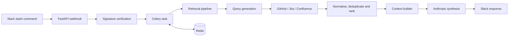

# JARVIS — Joint Archival Retrieval of Verbose Information Systems


JARVIS is a retrieval-first engineering assistant that answers technical questions using evidence gathered from software development tools. It retrieves relevant context from GitHub, Jira, and Confluence before asking an LLM to synthesize an answer, and delivers the result through a Slack slash command.

The project is built with **Python, FastAPI, Celery, Redis, and the Anthropic API**. It is a working prototype/portfolio project, not a turnkey hosted service.

## What it does

A user submits a question in Slack:

```text
/jarvis how does the authentication flow work?
```

JARVIS then:

1. verifies the incoming Slack request;
2. parses the question and optional retrieval scope;
3. generates focused search queries;
4. retrieves relevant material from GitHub, Jira, and Confluence;
5. normalizes scores per source, removes duplicates within each source, applies per-source limits and ranks the results heuristically;
6. formats the top results (up to ten) into a plain-text context with source labels and URLs;
7. uses Anthropic to synthesize an answer from that context;
8. posts the answer back to Slack with a footer showing how many results came from each source.

The application also exposes `GET /health` for a basic health check and `GET /metrics` for Prometheus. The worker serves its own metrics on port 9100; see [Observability](#observability).

## Architecture



### Main components

| Component | Responsibility |
|---|---|
| FastAPI | HTTP API and Slack webhook |
| Slack integration | Request signature verification and response formatting |
| Celery | Asynchronous execution of retrieval and answer generation |
| Redis | Celery broker and result backend |
| Retrieval pipeline | Coordinates query generation and source retrieval |
| GitHub, Jira, Confluence providers | Fetch and normalize source-specific results |
| Context builder | Formats the top-ranked results into a plain-text context |
| Anthropic client | Generates the final answer from the question and retrieved context |

The implementation is deliberately retrieval-first: the LLM is given source material gathered for the question rather than being asked to answer solely from its general knowledge. The system prompt instructs the model to base implementation details on that material, but answers are not checked against it and do not include per-claim citations.

## Technical highlights

- FastAPI application with a separate Celery worker.
- Asynchronous retrieval across multiple external providers.
- Provider-specific connectors with HTTP timeout and retry handling.
- Query generation and intent-aware retrieval.
- Per-source score normalization, within-source deduplication, heuristic ranking, and per-source limits.
- Context construction with source labels and URLs, plus a per-source result-count footer in each answer.
- Slack request-signature verification.
- Retrieved content treated as untrusted input: delimited in the prompt, with system-prompt instructions not to follow instructions found inside it.
- Anthropic API integration for context-based answer synthesis.
- Unit and integration tests using pytest, mocks, and fixtures.
- Structured JSON logs with a correlation ID shared by the API, the Celery worker and Celery's own log lines, plus Prometheus metrics for both processes.
- Optional LangGraph agent mode in which Claude chooses which sources to search through tools, with a limit on tool rounds.
- Offline retrieval evaluation (recall@k, MRR per source) over a fixed synthetic corpus, run in CI as a regression gate.
- Docker Compose setup for local API, worker, and Redis services.

## Project structure

```text
app/
  api/                 FastAPI routes and Slack webhook
  connectors/          GitHub, Jira, Confluence and HTTP utilities
  agent/               Optional LangGraph agent: search tools and graph
  observability/       Correlation ID, Celery logging signals, Prometheus metrics
  llm/                 Anthropic client, prompts and deterministic helpers
  retrieval/           Query generation, providers, ranking and context building
  slack/               Slack verification and response formatting
  workers/             Celery application and background tasks
tests/
  unit/
  integration/
eval/                  Offline retrieval evaluation: corpus, golden set, metrics, runner
docs/
  architecture.md
  development.md
```

## Requirements

- Python 3.12
- Poetry
- Docker and Docker Compose
- Credentials for the integrations you want to use:
  - Slack app signing secret
  - Anthropic API key
  - GitHub token
  - Jira token, base URL and account email
  - Confluence base URL (Confluence requests reuse the Jira email and token)

The application can be configured for the providers available to your team. GitHub repository lists and retrieval scopes are supplied through environment variables; no organization-specific repository defaults are included.

## Local setup

Clone the repository and install dependencies:

```bash
poetry install --with dev
```

Create a local environment file from the template (Docker Compose requires `.env` to exist):

```bash
cp .env.example .env
```

Replace the placeholder values in `.env`. At minimum, a live Slack request requires `SLACK_SIGNING_SECRET`, and live answer synthesis requires `ANTHROPIC_API_KEY` (or set `LLM_STUB_MODE=true`). Provider credentials are needed only for the integrations you use.

Start the local stack:

```bash
docker compose up --build
```

The Compose stack starts:

- the FastAPI application on port `8000`;
- the Celery worker, with its metrics endpoint on port `9100`;
- Redis on port `6379`.

Check the API:

```bash
curl http://localhost:8000/health
```

Expected response:

```json
{"status": "ok"}
```

## Configuration

All settings are defined in [`app/config.py`](app/config.py) and can be supplied through environment variables or the local `.env` file.

The main settings include:

| Variable | Purpose |
|---|---|
| `SLACK_SIGNING_SECRET` | Verifies incoming Slack requests |
| `SLACK_ALLOWED_USER_IDS` | Optional comma-separated allowlist of Slack user IDs; empty allows all users |
| `ANTHROPIC_API_KEY` | Enables live answer synthesis |
| `ANTHROPIC_MODEL_FAST`, `ANTHROPIC_MODEL_SYNTHESIS` | Optional model overrides for query generation and answer synthesis |
| `LLM_STUB_MODE` | Enables stubbed LLM responses for tests/development |
| `LOG_LEVEL`, `LOG_FORMAT` | Log level (default `INFO`) and format: `json` (default) or `text` |
| `WORKER_METRICS_PORT` | Port of the worker's metrics endpoint (default `9100`) |
| `PROMETHEUS_MULTIPROC_DIR` | Worker only, set by Docker Compose. Turns on prometheus_client multiprocess mode and the worker's metrics endpoint. Do not set it for the API |
| `AGENT_MODE`, `AGENT_MAX_TOOL_ROUNDS` | Optional agent mode (off by default) and its limit on rounds of tool calls (default 4, allowed 1–8); see [Agent mode](#agent-mode-optional) |
| `GITHUB_TOKEN` | Authenticates GitHub retrieval |
| `GITHUB_REPOS` | Default GitHub repositories to search; if empty, code search is not restricted to any repository |
| `GITHUB_CF_REPOS`, `GITHUB_PY_REPOS` | Optional repository lists for the `cf` / `py` scope prefixes |
| `GITHUB_*_ALLOWED_EXTENSIONS`, `GITHUB_*_EXTENSION_SCORES` | Optional file-extension filters and ranking weights (default, `CF` and `PY` profiles) |
| `JIRA_TOKEN`, `JIRA_BASE_URL`, `JIRA_EMAIL` | Jira connection settings (Atlassian Cloud REST API v3) |
| `CONFLUENCE_BASE_URL` | Confluence site root, without `/wiki`; authenticates with the Jira email and token; empty disables Confluence |
| `REDIS_URL` | Celery broker/backend URL |
| `RETRIEVAL_SOURCE_CAPS` | Maximum number of results retained per source |
| `RETRIEVAL_*_KEYWORDS` | Terms used by retrieval intent and query preprocessing |

List and mapping values must be written as JSON, for example `GITHUB_REPOS=["your-org/your-repo"]` or `RETRIEVAL_SOURCE_CAPS={"github": 6, "jira": 3, "confluence": 1}`. Comma-separated values are not parsed by the settings loader.

See [`.env.example`](.env.example) for all supported keys, defaults and formats. Keep real credentials in `.env` or your secret manager; never commit them.

## Tests and code quality

Run the test suite:

```bash
poetry run pytest -q
```

Run Ruff:

```bash
poetry run ruff check .
```

Ruff and the test suite run in GitHub Actions on every push and pull request (see `.github/workflows/ci.yml`). Run the same checks locally with the commands above.

## Agent mode (optional)

By default JARVIS runs a fixed pipeline. It generates search queries, queries GitHub, Jira and Confluence at the same time, ranks the results and synthesises an answer. With `AGENT_MODE=true`, the evidence-gathering step is replaced by a small [LangGraph](https://github.com/langchain-ai/langgraph) agent in `app/agent/`:

```text
decide ──(tool calls)──> run_tools ──(rounds left)──> decide
   └──(no tool calls)──> finish <──(round limit hit)──┘
```

- **decide:** Claude (`ANTHROPIC_MODEL_FAST`) sees the question and three tools: `search_github`, `search_jira` and `search_confluence`. It calls the ones it thinks will help, with short keyword queries.
- **run_tools:** each tool searches one source through the same providers as the fixed pipeline. At most 3 tool calls run per round; extra calls get an error result. Tool output is limited to 4,000 characters of content per call, then escaped and wrapped in `<retrieved_context>` tags. A failing source or an invalid tool call comes back to Claude as an error result instead of stopping the run.
- **Loop limit:** the loop stops when Claude stops calling tools, or after `AGENT_MAX_TOOL_ROUNDS` rounds of tool calls (default 4, allowed 1–8).
- **finish:** everything found is ranked with the same normalisation, GitHub bias and per-source caps as the fixed pipeline, and formatted as the same context block. The ranking is not equivalent to the fixed pipeline's, though. Each provider scores a result against the query that found it, and each agent tool call uses its own query. Scores from different agent queries are therefore not directly comparable, even after per-source normalisation.

After that, both modes do the same thing: answer synthesis through `ask_llm`, the current-state guardrail and the source footer. In `LLM_STUB_MODE`, agent mode falls back to the fixed pipeline, because there is no real model to choose tools.

### Tradeoffs compared with the fixed pipeline

| | Fixed pipeline (default) | Agent mode |
|---|---|---|
| Claude calls per question | 2: query generation and synthesis | One decide call per tool round, one more if Claude stops searching by itself, and synthesis. That is at most `AGENT_MAX_TOOL_ROUNDS` + 1, so 5 with the default limit |
| Source calls | All three sources, every time, in parallel | Only the sources Claude picks: at most 3 searches per round, so 12 with the default limit. Rounds run one after another, which adds latency |
| Queries per source | Up to 5 generated queries | One query per tool call. Claude can retry with different keywords |
| Repeatability | The search plan is fixed; only the generated queries can vary | Which sources are searched, and how often, can differ between runs |
| Prompt-injection surface | Retrieved text reaches only the synthesis call | Retrieved text also reaches the calls that decide the next search. It is delimited, escaped and size-capped, which reduces this risk but does not remove it |
| Evaluation | Covered by the offline eval | **Not measured.** The offline eval runs in stub mode, where agent mode uses the fixed pipeline |

Agent mode is a demonstration of tool-based retrieval, not a measured improvement. No claim is made that it gives better answers than the fixed pipeline.

### Known limitations of agent mode

- **Retrieved text can steer later searches.** Claude writes each search query after reading earlier tool output, so injected text in a ticket, page or file could try to influence the next query. Tool input is checked only for type and length (200 characters). Search syntax is not removed. A GitHub query could, for example, add qualifiers such as `repo:` or `org:` and search beyond `GITHUB_REPOS`, within what the GitHub token can read. The fixed pipeline already passes generated queries to the connectors unchanged. What is new in agent mode is that third-party content can influence those queries. Hardening query handling in the connectors is planned as a separate task.
- **LangSmith tracing.** Installing LangGraph also installs the `langsmith` package. JARVIS does not configure or enable it. LangSmith tracing is off unless it is turned on through environment variables, such as `LANGSMITH_TRACING` with a LangSmith API key. If it is enabled, the agent's graph state may be sent to LangSmith, including the question, Claude's messages and retrieved content. Leave these variables unset unless you intend that.

## Observability

### Logs

Both processes write one JSON object per line to stderr. Set `LOG_FORMAT=text` for a readable format with the same fields.

```json
{"timestamp": "2026-11-10T13:56:31.808+00:00", "level": "INFO", "logger": "celery.worker.strategy", "process": "MainProcess", "message": "Task app.workers.tasks.process_jarvis_query[3157d1ed-...] received", "correlation_id": "3157d1ed-..."}
```

Fields: `timestamp` (UTC), `level`, `logger`, `process`, `message`, `correlation_id`, and, when present, `client_request_id` and `exception`.

**Correlation ID**
- The API generates a UUID for every request. It returns it in the `X-Correlation-ID` response header and uses it as the Celery task ID.
- The worker sets it for the task's duration (`task_prerun` / `task_postrun`), so the task's own log lines carry it.
- Celery's own lines (received, retry, succeeded, failed) carry the same value. Celery attaches the task ID to those log records, including the "received" line that is logged before the task starts.
- Celery keeps the task ID on retries, so every attempt has the same `correlation_id`.
- A client's `X-Request-ID` header is never used as the task ID. It is only logged as `client_request_id`, truncated to 128 characters.

**What the logs contain.** The logs are not free of personal or sensitive data:
- Queries, result titles and snippets, the raw Claude query response, and the 2,000-character context preview are logged only at `DEBUG`.
- At `INFO` and `WARNING`, lines carry counts and error types. Exception messages can still contain request URLs, which include search query text.
- Treat logs as sensitive at every level.

### Metrics

| Endpoint | Process | Content |
|---|---|---|
| `:8000/metrics` | API | API metrics only |
| `:9100/metrics` | Celery worker | Sum of the worker parent and all its child processes |

**Deployment note.** `/metrics` is on the same port as the Slack webhook. A deployment must put a reverse proxy in front of the API that forwards only `/slack/*` from the internet, so that `/metrics` and `/health` are reachable only internally. That proxy is not part of this repository. Port 9100 should not be exposed publicly either.

**API metrics**

| Metric | Labels |
|---|---|
| `jarvis_api_request_duration_seconds` | `outcome` (status class, e.g. `2xx`). Scrapes of `/metrics` are not counted |
| `jarvis_api_tasks_enqueued_total` | `outcome` (`success`, `error`) |

**Worker metrics**

| Metric | Labels |
|---|---|
| `jarvis_task_duration_seconds` | `mode` (`pipeline`, `agent`), `outcome` (`success`, `retry`, `failure`) |
| `jarvis_task_retries_total` | `reason` (`slack_5xx`, `slack_timeout`, `slack_network`) |
| `jarvis_source_request_duration_seconds` | `source` (`github`, `jira`, `confluence`), `outcome` (`success`, `error`) |
| `jarvis_http_retries_total` | `source`, `reason` (`status_429`, `status_5xx`, `timeout`, `network`) |
| `jarvis_http_timeouts_total` | `source` |
| `jarvis_llm_request_duration_seconds` | `mode` (`query_generation`, `synthesis`, `agent_decide`), `outcome` |
| `jarvis_llm_input_tokens_total`, `jarvis_llm_output_tokens_total` | `mode` |

Source errors are the `outcome="error"` count of `jarvis_source_request_duration_seconds`. Label values come from a small fixed set. User IDs, queries, URLs, titles and Jira keys are never used as labels.

**Why the worker has its own endpoint.**
- The Celery worker uses the prefork pool, so tasks run in forked child processes that each keep their own metric values.
- Docker Compose sets `PROMETHEUS_MULTIPROC_DIR` for the worker only, on a `tmpfs` mount. Every process writes its values to files there, and the worker parent serves their sum on port 9100.
- Old files would be added to the new totals, so the directory is cleared by a separate command (`python -m app.observability.worker_metrics`) before Celery starts, never inside the running worker.
- The API imports the worker code, so it has the worker metrics in memory too. It serves only its own registry, so they do not appear on `:8000/metrics`.

### Optional: local Prometheus and Grafana

```bash
docker compose --profile monitoring up --build
```

- **Prometheus** (`http://localhost:9090`) scrapes `api:8000` and `worker:9100` every 15 seconds.
- **Grafana** (`http://localhost:3000`) starts with Prometheus as its data source. Grafana's default `admin` login applies, and it asks you to change the password at first login. No dashboards are included; use Grafana's Explore view.
- Both are bound to `127.0.0.1` and are meant for local use only.
- A plain `docker compose up` does not start them.

**Not measured:**
- Celery queue length. It would need a Redis call on every scrape, and it is not implemented.
- Per-process CPU and memory of the worker's child processes. prometheus_client does not aggregate them in multiprocess mode.

## Evaluation

`eval/` contains an offline retrieval evaluation. It runs the real query fallback, connectors, providers and ranking (`retrieve()`) against a fake HTTP backend that serves a small synthetic corpus, and scores the ranked results against hand-labelled relevant documents.

```bash
poetry run python -m eval.run_retrieval_eval
```

It needs no credentials or network access. Unknown URLs fail instead of being requested. A run takes a few seconds and writes per-question details to `eval/results/retrieval.json`.

**What is measured:** the deterministic query fallback (query generation runs in stub mode), JARVIS's local re-scoring, per-source normalisation, GitHub bias, per-source caps and the final top-10 ranking.

**What is not measured:** the quality of GitHub, Jira or Confluence search (the fake backend selects candidates with simple word overlap), LLM-generated queries, behaviour on real data, or answer quality.

### Results

Current numbers from `eval/results/retrieval.json`: 20 questions over 19 GitHub files, 12 Jira issues and 8 Confluence pages.

| Source | Questions | Recall@5 | Recall@10 | MRR |
|---|---|---|---|---|
| Overall | 20 | 0.83 | 0.95 | 0.76 |
| GitHub | 20 | 0.78 | 0.97 | 0.74 |
| Jira | 12 | 1.00 | 1.00 | 0.42 |
| Confluence | 11 | 0.73 | 0.82 | 0.25 |

Per-source rows count only that source's relevant documents, but use their positions in the final merged ranking. The low Jira and Confluence MRR reflects the deliberate GitHub bias and the default cap of one Confluence result. The misses come from the query fallback. It keeps question words such as "why" and "which", and for database questions it can pick "which" as the entity to search for.

Caveats: the corpus and labels were written by the project author and are small. The numbers detect regressions in this code. They are not a benchmark of retrieval quality on real repositories. Settings in a local `.env` (caps, keywords, extensions) change the results; the committed numbers use the defaults. After the first run, the fake backend was changed to split identifiers such as `payment_service` into separate words, as real search engines do; this raised overall recall@10 from 0.89 to 0.95.

CI runs the eval and fails if overall recall@10 drops below 0.90. That gate was set just below the first measured value of 0.95.

### Optional: LLM-as-judge groundedness check

`eval/judge.py` retrieves context the same way, generates an answer through the normal synthesis path, and asks Claude whether every claim in the answer is supported by the context. Both the context and the answer are passed to the judge as delimited, untrusted data. It makes paid API calls, so it is off unless you opt in:

```bash
EVAL_LLM_JUDGE=1 ANTHROPIC_API_KEY=... poetry run python -m eval.judge
```

The output goes to `eval/results/judge.json`, which is gitignored. No judge results are published in this repository, and a judge model can itself be wrong.

## Current scope and limitations

- Slack is the implemented user interface; this is not currently a general-purpose web chat application.
- Retrieval depends on access to the configured external APIs and their permissions.
- Answer quality depends on the relevance and completeness of retrieved source material. Retrieval ranking is evaluated offline against a small synthetic corpus (see [Evaluation](#evaluation)); there is no evaluation against real GitHub, Jira or Confluence data, and no published measurement of answer quality.
- The retrieval and ranking stages use application logic and heuristics; there is no vector database or semantic code index in the current implementation.
- The project does not include a hosted production deployment or infrastructure provisioning.
- Conversation history is not persisted as long-term assistant memory.
- Agent mode is optional, off by default and not covered by the offline evaluation.
- If posting the answer to Slack fails with a timeout, a network error or a 5xx response, Celery retries the whole task, up to 2 times. A retry reruns retrieval and every Claude call. If Slack had already accepted the first post (for example, a timeout after delivery), the user receives the answer twice. This is not prevented. Retries are counted in `jarvis_task_retries_total`.
- Logs are not PII-free (see [Observability](#observability)). There is no distributed tracing; requests are correlated through the `correlation_id` log field only.
- Prompt-injection handling is a prompt-level mitigation (untrusted-content instructions and delimiters), not complete protection.

JARVIS is intended to demonstrate practical backend engineering: API integration, asynchronous processing, retrieval orchestration, failure handling, testing, and LLM integration.
